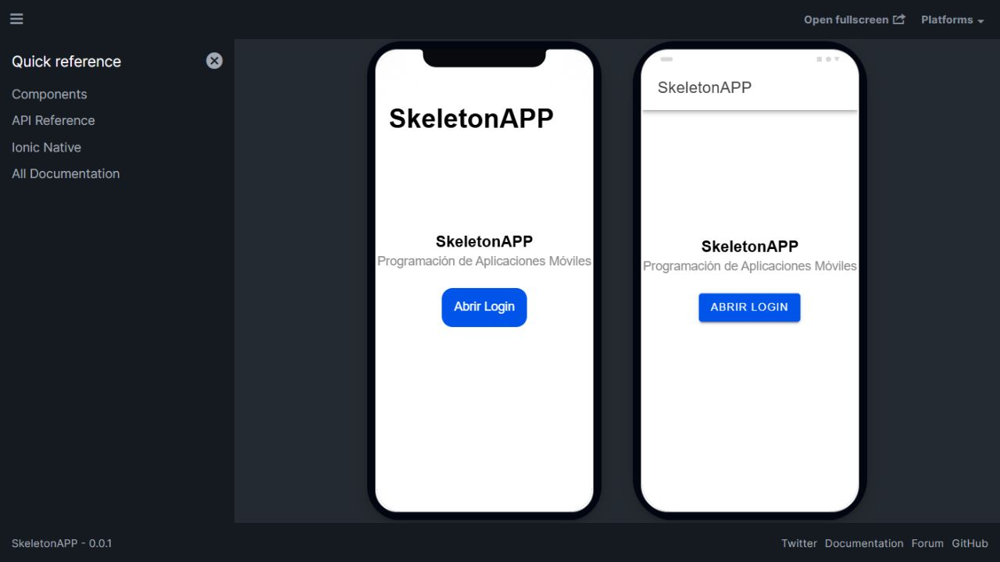
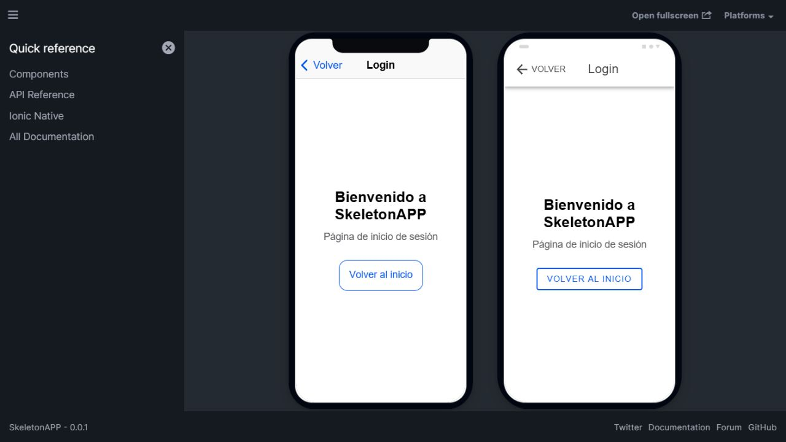

# SkeletonAPP

Proyecto de la asignatura Programación Aplicaciones Móviles PGY4221 de Duoc UC.
La base se generó con Ionic CLI usando la plantilla `blank` y Angular con módulos
(`NgModule`).

## Requisitos

- Node.js 24.13.1 y npm 11.8.0, verificados en el equipo de desarrollo.
- Ionic CLI 7.2.0.
- Visual Studio Code o un editor equivalente.

El proyecto usa Angular 21 para mantener compatibilidad con el Node.js instalado.
Las versiones resueltas de las dependencias quedan registradas en `package-lock.json`.

Dependencias principales instaladas: Ionic Framework 9.0.9, Angular 21.2.25
y Capacitor 8.5.3.

## Instalar y ejecutar

Desde la carpeta raíz del repositorio:

```powershell
npm ci
ionic serve --host=127.0.0.1 --port=8100
```

La aplicación estará disponible en `http://127.0.0.1:8100`. Para detenerla,
presiona `Ctrl+C` en la terminal.

## Inicio y Login

La ruta `/` redirige a `/home`. Desde Inicio, el botón **Abrir Login** permite
acceder a `/login`. La página Login tiene un botón de regreso en la cabecera
y otro botón **Volver al inicio**.

Login se generó mediante el comando:

```powershell
ionic generate page Login --no-interactive
```

La página ya está creada. Este comando se conserva como registro del proceso;
su salida está en [generacion-login.txt](evidencias/generacion-login.txt).
El alcance actual de Login es la estructura y navegación de la página.

## Visualizar iOS y Android con Ionic Lab

Mantén `ionic serve` ejecutándose en el puerto 8100. En una segunda terminal,
desde la misma carpeta del proyecto, ejecuta:

```powershell
npm run lab
```

Abre `http://127.0.0.1:8200` para ver las dos presentaciones móviles.
Para abrir directamente Login en ambos dispositivos, detén Lab con `Ctrl+C`
y ejecuta `npm run lab:login` en su lugar.
El script utiliza la instalación local de `@ionic/lab` 3.2.15 y su dependencia
`semver`, ambas incluidas en `package-lock.json`; no depende de la instalación
global de Ionic Lab. Para detener Lab, presiona `Ctrl+C` en su terminal.

Ionic Lab muestra vistas web en formatos iOS y Android. La configuración de
Capacitor está preparada para el desarrollo móvil; las plataformas nativas y
sus instaladores se generan en una etapa posterior.

En `angular.json`, el servidor de desarrollo tiene `prebundle: false` para
evitar el error de renderizado observado al preempaquetar componentes Ionic.
Esta opción se aplica al servidor de desarrollo.

## Compilar

```powershell
ionic build
```

La compilación genera los archivos web en `www/`.

## Verificar el código

```powershell
npm run lint
npm test -- --watch=false
```

## Estructura del proyecto

- `src/app/`: módulo principal y rutas.
- `src/app/home/`: página inicial y acceso a Login.
- `src/app/login/`: página Login, módulo, rutas, estilos y prueba.
- `src/assets/`: recursos estáticos.
- `src/theme/`: variables de estilo de Ionic.
- `angular.json`: configuración de compilación y herramientas de Angular.
- `ionic.config.json`: nombre y tipo de proyecto Ionic.
- `capacitor.config.ts`: configuración del contenedor móvil Capacitor.
- `evidencias/`: registros de ejecución, capturas y comprobaciones de la actividad.

## Evidencias de la semana 1

- [Versiones del entorno](evidencias/versiones-entorno.txt).
- [Generación de Login con CLI](evidencias/generacion-login.txt).
- [Ejecución de Ionic](evidencias/ejecucion-ionic.txt).
- [Ejecución de Ionic Lab](evidencias/ejecucion-lab.txt).
- [Ejecución de Ionic Lab con Login](evidencias/ejecucion-lab-login.txt).
- [Resultados de lint, pruebas y compilación](evidencias/verificacion-local.txt).
- [Comprobación de navegación y modos móviles](evidencias/verificacion-navegacion.md).

Inicio en Ionic Lab:



Login en Ionic Lab:



## Control de versiones

El desarrollo de la semana 1 se realiza en la rama `semana-1` del repositorio
https://github.com/fesantibanezl/SkeletonApp.

Enlace directo de la rama:
https://github.com/fesantibanezl/SkeletonApp/tree/semana-1.

Los cambios se preparan y verifican localmente. El estudiante ejecuta los
comandos que registran y publican el avance:

```powershell
git status
git add .
git commit -m "feat: completar actividad semana 1 con Login y evidencias"
git log -1 --oneline
git remote -v
git push origin semana-1
```

El respaldo remoto se actualiza al ejecutar el `push`.

`node_modules/`, `www/` y `.angular/` están excluidos mediante `.gitignore`.
